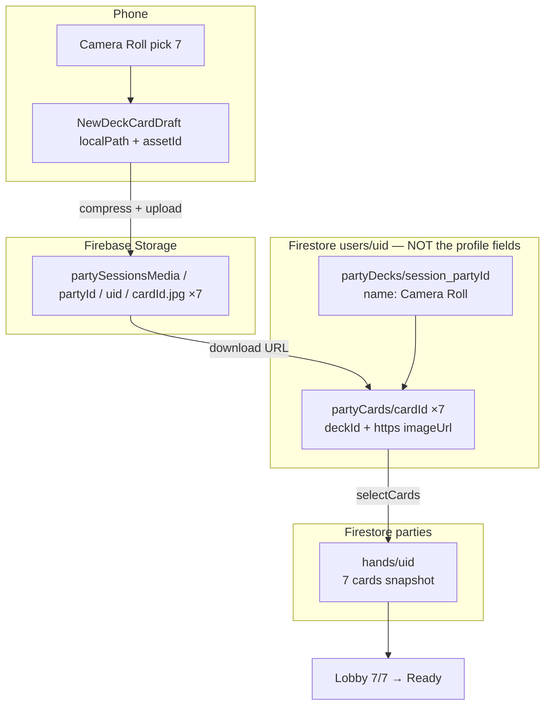

# Party Session Media Hierarchy — 7 Camera Roll Photos

---

## 1. Firebase Storage path (the actual JPG files)

```
partySessionsMedia / {partyId} / {uid} / {cardId}.jpg
       │                 │         │         │
       │                 │         │         └── ONE uploaded photo file
       │                 │         │             (one of the 7; cardId is unique)
       │                 │         │
       │                 │         └── YOUR Firebase Auth UID
       │                 │             (only you write your folder)
       │                 │
       │                 └── This party session (e.g. 498932)
       │                     (scoped so cleanup can wipe one party)
       │
       └── Root folder for TEMPORARY party photos
           (not Decks, not Quick Pics, not profile)
```

### What each segment means

| Segment | Example | Meaning |
|--------|---------|---------|
| `partySessionsMedia` | — | Temporary party-only media bucket prefix |
| `{partyId}` | `498932` | Which party lobby these 7 belong to |
| `{uid}` | `PtOJ7D6UCzfv…` | Which member uploaded them |
| `{cardId}.jpg` | `abc123.jpg` | One of the 7 cards |

### Under party ID, user UID, or both?

**Both — nested.**

```
partySessionsMedia/
└── 498932/                          ← party owns the session scope
    └── PtOJ7D6UCzfvLy8ymLYanpGnayJ2/ ← you own the files inside
        ├── cardA.jpg                ← photo 1 of 7
        ├── cardB.jpg                ← photo 2 of 7
        ├── cardC.jpg
        ├── cardD.jpg
        ├── cardE.jpg
        ├── cardF.jpg
        └── cardG.jpg                ← photo 7 of 7
```

- **Party ID** = which session (cleanup deletes this whole branch when party ends).
- **UID** = who uploaded (rules: only that user writes their folder).
- Photos are **not** stored under `users/{uid}/…` in Storage for this flow.
- Photos are **not** permanent Decks/Quick Pics Storage (those stay local-only).

---

## 2. Firestore vs Storage — what references the photos?

```
┌─────────────────────────────────────────────────────────────┐
│  users/{uid}   (profile / “user table”)                     │
│  email, username, photoUrl (profile pic), onboarding…       │
│                                                             │
│  ❌ Does NOT store the 7 party session photo URLs           │
│  ❌ Does NOT list partySessionsMedia paths                  │
└─────────────────────────────────────────────────────────────┘
         │
         │  subcollections (same user, separate docs)
         ▼
┌─────────────────────────────────────────────────────────────┐
│  users/{uid}/partyDecks/session_{partyId}                   │
│  { name: "Camera Roll" }  (± favorite)                      │
│                                                             │
│  Owns the ephemeral “deck” container for this party hand.   │
│  Does NOT hold image bytes or URLs.                         │
└─────────────────────────────────────────────────────────────┘
         │
         │  deckId points here
         ▼
┌─────────────────────────────────────────────────────────────┐
│  users/{uid}/partyCards/{cardId}   × 7 docs                 │
│  { deckId: "session_498932",                                │
│    imageUrl: "https://…/partySessionsMedia/…/cardA.jpg" }   │
│                                                             │
│  ✅ THIS is where each of the 7 HTTPS links lives.          │
│  Party rules require imageUrl to match ^https://.*          │
└─────────────────────────────────────────────────────────────┘
         │
         │  selectCards(partyId, [7 cardIds])
         ▼
┌─────────────────────────────────────────────────────────────┐
│  parties/{partyId}/hands/{uid}                              │
│  { cards: [ {id, deckId, imageUrl}, … ×7 ], revision }      │
│                                                             │
│  Lobby reads this → shows 7/7 → Ready can unlock.           │
└─────────────────────────────────────────────────────────────┘
```

**Answer for Thabang:**  
The 7 images are **files in Storage** under `partySessionsMedia/{partyId}/{uid}/`.  
They are **referenced** from `partyCards` (and then copied into the party `hands` doc).  
They are **not** fields on the main `users/{uid}` profile document.

---

## 3. Full chain (Camera Roll → Ready)

```text
  PHONE                         CLOUD                         LOBBY UI
  ─────                         ─────                         ────────

  [Camera Roll]
       │ pick exactly 7
       │ Save → List<NewDeckCardDraft>
       │        (localPath + assetId only)
       ▼
  [PartySessionCardSyncService]
       │
       │ 1. Compress each local file
       │ 2. Upload → Storage
       │      partySessionsMedia/{partyId}/{uid}/{cardId}.jpg
       │ 3. getDownloadURL() → https://…
       │
       │ 4. Ensure partyDecks/session_{partyId}
       │ 5. Write 7× partyCards/{cardId}
       │      { deckId, imageUrl: https://… }
       │
       │ 6. Return [cardId × 7]
       ▼
  [PartyActions.selectCards(partyId, ids)]
       │
       │ Reads partyCards (canonical https)
       │ Writes parties/{partyId}/hands/{uid}
       │ Updates member cardCount / selectionRevision
       ▼
  [Lobby]
       “7/7 cards selected”
       Ready button enabled
```

### One card’s ownership (example)

| Layer | Path / doc | Owns |
|-------|------------|------|
| Bytes | `partySessionsMedia/498932/{uid}/cardA.jpg` | Temporary file for this party + user |
| Catalog link | `users/{uid}/partyCards/cardA` | Points at that HTTPS URL + deckId |
| Deck label | `users/{uid}/partyDecks/session_498932` | Named container (“Camera Roll”) |
| Hand | `parties/498932/hands/{uid}` | Snapshot of the 7 cards for Ready/play |
| Profile | `users/{uid}` | Unrelated (profile pic only) |

---

## 4. Mermaid (same story)



---

## 5. Cleanup

### On Change Cards / re-Save (implemented)

Before uploading a new set of 7, `PartySessionCardSyncService` deletes:

1. All files under `partySessionsMedia/{partyId}/{uid}/`
2. All `partyCards` with `deckId == session_{partyId}`

Then uploads the new 7 and calls `selectCards` again.

### On leave / disband / kicked / party ended (implemented)

`cleanupSessionMedia` deletes that user’s:

1. Storage folder `partySessionsMedia/{partyId}/{uid}/`
2. Ephemeral `partyCards` for `session_{partyId}`
3. `partyDecks/session_{partyId}`

Wired from lobby `exitParty`, home leave/disband, and the ended/kicked lobby screen.
Each member cleans their own media (Storage rules are owner-only).

Permanent Decks / Quick Pics local refs are untouched.
